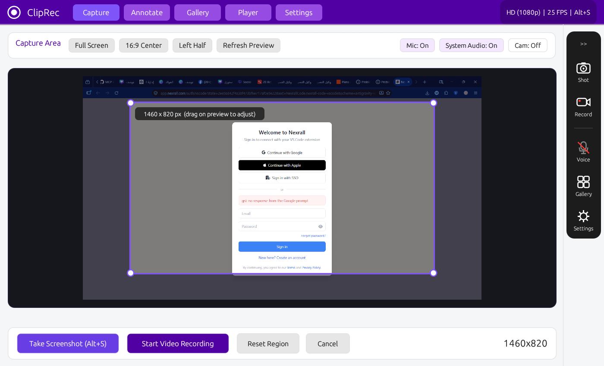
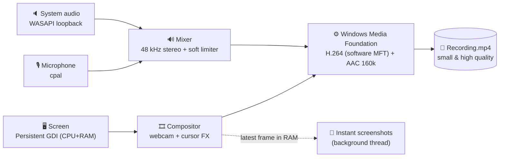

<div align="center">


<br/>

[](https://github.com/mmdk11278-hub/cliprec/releases/latest)
[](https://github.com/mmdk11278-hub/cliprec/releases)
[](https://github.com/mmdk11278-hub/cliprec/releases/latest)
[](https://www.rust-lang.org/)
[](#-how-it-works)

<br/>

# ⬇️ [Download ClipRec-Setup.exe](https://github.com/mmdk11278-hub/cliprec/releases/latest/download/ClipRec-Setup.exe)

**One click install · Desktop & Start Menu shortcuts · Custom icon · Runs as Administrator**

<sub>Prefer portable? Grab <a href="https://github.com/mmdk11278-hub/cliprec/releases/latest/download/cliprec.exe"><code>cliprec.exe</code></a> directly.</sub>

</div>

---

## ✨ What is ClipRec?

ClipRec is a **lightweight, fast screen recorder for Windows** built in Rust. It records your screen, microphone, system sound and webcam straight into a **small, high-quality MP4** — with **no FFmpeg, no GPU dependency and no external tools**.
It is designed for **tutorials, lectures and demos**: your mouse is always visible with a highlight so viewers can follow along.

<p align="center">
  
</p>

---

## 🚀 Highlights (v0.4)

| | Feature | Details |
|---|---|---|
| ⚡ | **Fast CPU + RAM pipeline** | Persistent GDI capture, integer fixed-point RGB→NV12 conversion and a multi-threaded software H.264 encoder. Does **not** fight your GPU, so games and browsers stay smooth. |
| 🎬 | **Direct MP4 (H.264 + AAC)** | Written live to disk through Windows **Media Foundation**. 1080p30 ≈ **4.5 Mbps** → roughly **30 MB per 10 minutes at 720p–1080p**. Stop = file is already ready. |
| 🔊 | **Clean voice + system audio** | Microphone and WASAPI system loopback are mixed at 48 kHz stereo with a soft-knee limiter (no harsh clipping) and **160 kbps AAC**, written in continuous 2048-sample blocks for glitch-free sound. |
| 🖱️ | **Tutorial mouse pointer** | The real cursor is drawn into every frame with a **halo, spotlight, click-ripple or colored arrow** so explanations are easy to follow. |
| 🎓 | **Lecture Mode** | One click = full screen + webcam bubble + mic + system audio + highlighted cursor, with a 3-second countdown. |
| 📸 | **Zero-freeze screenshots** | Take a screenshot **while recording** — it is grabbed from RAM and saved on a background thread, so the recording never hiccups. |
| ✂️ | **Built-in video editor** | Trim, split, delete, reorder and merge clips, then export back to MP4 — no external software. |
| 🎥 | **Webcam bubble** | Small / Large / Full-frame overlay with automatic MJPEG → YUYV fallback for compatibility. |
| 🛡️ | **Always Administrator** | UAC manifest embedded so ClipRec can capture elevated windows and protected apps. |
| 🖼️ | **Annotation editor** | Arrows, frames, callouts and text with an 80-colour palette. Copy or save as PNG. |

---

## 🧠 How it works



**Why it is fast:** no GPU readback, no double encoding, no FFmpeg process, constant memory use — frames flow screen → RAM → encoder → disk.

---

## 📥 Installation

1. Download **[ClipRec-Setup.exe](https://github.com/mmdk11278-hub/cliprec/releases/latest/download/ClipRec-Setup.exe)**
2. Run it and click **Install** (accept the UAC prompt)
3. Launch **ClipRec** from the Desktop or Start Menu

Silent install: `ClipRec-Setup.exe --silent`

Recordings are saved to `%LOCALAPPDATA%\ClipRec\Records`.

---

## ⌨️ Shortcuts

| Shortcut | Action |
|---|---|
| `Alt + S` | Screenshot (idle) · Stop & save (recording) |
| `Alt + Q` | Pause / Resume recording |
| `Alt + D` | Toggle voice indicator |
| `Ctrl + Z` / `Ctrl + Y` | Undo / Redo in the annotation editor |
| `Space` · `←` · `→` | Play/Pause · −10 s · +10 s in the player |

---

## 🛠️ Build from source

```powershell
# Requirements: Windows 10/11 + Rust (stable-x86_64-pc-windows-gnu)
cargo test --bin cliprec
cargo build --release --bin cliprec          # target\release\cliprec.exe
cargo build --release --bin ClipRec-Setup    # self-contained installer
```

<details>
<summary><b>Project layout</b></summary>

| File | Purpose |
|---|---|
| `src/recorder.rs` | Capture loop, audio mixing, webcam, preview/latest-frame |
| `src/mf.rs` | Media Foundation MP4 writer/reader, integer RGB→NV12 |
| `src/capture.rs` | Persistent GDI capture, fast PNG, helpers |
| `src/app.rs` | egui UI: studio, gallery, player, editor, settings |
| `src/audio_loopback.rs` | WASAPI system-audio capture |
| `src/bin/cliprec-setup.rs` | Windows installer |
| `build.rs` | Generates icon + embeds icon & admin manifest |

</details>

---

## 🇪🇬 بالعربي

**ClipRec** أداة تصوير شاشة سريعة جدًا لويندوز، بتسجّل الشاشة والمايك وصوت الجهاز والكاميرا في ملف **MP4 صغير وجودة عالية** مباشرة، **بدون FFmpeg وبدون الاعتماد على كارت الشاشة** (بتشتغل بالرام والبروسيسور).
مصممة للشرح والمحاضرات: **مؤشر الماوس بيظهر بعلامة واضحة** (هالة / سبوت لايت / موجة عند الضغط)، وفيه **وضع محاضرات بضغطة واحدة**، و**سكرين شوت أثناء التسجيل بدون أي تهنيج**، ومحرر فيديو مدمج للقص والدمج.

**التثبيت:** نزّل [ClipRec-Setup.exe](https://github.com/mmdk11278-hub/cliprec/releases/latest/download/ClipRec-Setup.exe) وشغّله — والتطبيق بيفتح دايمًا كمسؤول.

---

<div align="center"><sub>Made with ❤️ in Rust · <a href="https://github.com/mmdk11278-hub/cliprec/issues">Report an issue</a></sub></div>
