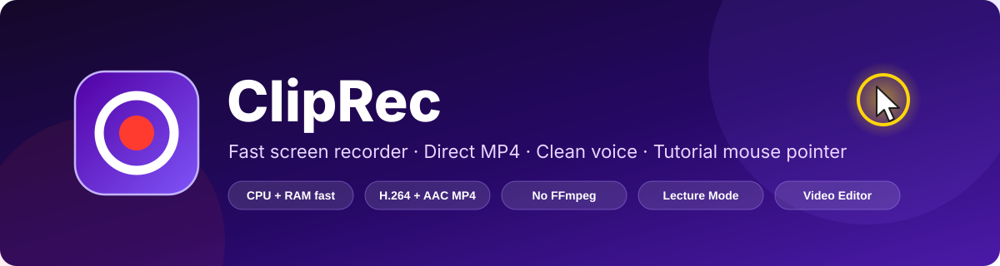

<div align="center">



<br/><br/>

[](https://github.com/mmdk11278-hub/cliprec/releases/latest)
[](https://github.com/mmdk11278-hub/cliprec/releases/latest/download/ClipRec-Setup.exe)
[](https://www.rust-lang.org/)
[-38C172?style=for-the-badge)](https://ffmpeg.org/)

<br/>

### **[Download ClipRec-Setup.exe (Windows Installer v0.3.0)](https://github.com/mmdk11278-hub/cliprec/releases/latest/download/ClipRec-Setup.exe)**
*One-click Windows setup wizard with Desktop & Start Menu shortcuts and custom brand icon.*

</div>

---

## Preview

<p align="center">
  
</p>

---

## Key Features

| Feature | Description |
|---|---|
| **Screen & Region Capture** | Capture full screen or any drag-selected region at **25 / 30 / 60 FPS** with GDI capture and background JPEG encoding. |
| **Compact MP4 (H.264 + AAC)** | Automatically saves recordings as fast-start `.mp4` files, plus one-click **Export MP4** and batch **Convert AVI -> MP4** in the Gallery. |
| **Audio-Clock Locked A/V Sync** | Frame pacing is locked to the hardware audio clock so video never drifts behind or ahead of voiceover. |
| **Studio Voice Enhancement** | Clean `cpal` microphone capture with optional FFmpeg voice chain (`highpass`, `lowpass`, `afftdn` noise reduction, and dynamic compression). |
| **Synchronized Video Player** | Built-in player driven by the master audio clock with scrubbing, `-10s`/`+10s` seek, `0.5x`–`2.0x` speed, and mute toggle. |
| **Live Webcam PiP Bubble** | Circular webcam overlay (Small / Large / Full Frame) composited live onto recordings. |
| **80-Color Annotation Editor** | Annotate screenshots with Arrows, Frames, Callouts, and Text, then save as PNG or copy directly to clipboard. |
| **Sticky Recording Sidebar** | Always-on-top, capture-excluded (`WDA_EXCLUDEFROMCAPTURE`) floating controls while recording. |

---

## Keyboard Shortcuts

| Shortcut | Action |
|---|---|
| `Alt + S` | Take screenshot (when idle) / Stop & save recording (when recording) |
| `Alt + Q` | Pause / Resume active recording |
| `Alt + D` | Toggle voice indicator |
| `Ctrl + Z` / `Ctrl + Y` | Undo / Redo in Annotation Editor |
| `Space` / `Left` / `Right` | Play/Pause & `-10s`/`+10s` seek in Video Player |

---

## Build From Source

### Requirements
- Windows 10 / 11
- [Rust](https://rustup.rs/) (`stable-x86_64-pc-windows-gnu`)
- [FFmpeg](https://ffmpeg.org/) on `PATH` (or `winget install Gyan.FFmpeg`) for MP4 recording & export

### Commands

```powershell
# 1. Run tests
cargo test --bin cliprec

# 2. Build the main recorder
cargo build --release --bin cliprec

# 3. Build the self-contained Windows Setup Installer (embeds cliprec.exe + icon)
cargo build --release --bin ClipRec-Setup
```

The compiled binaries will be at:
- `target\release\cliprec.exe`
- `target\release\ClipRec-Setup.exe`
